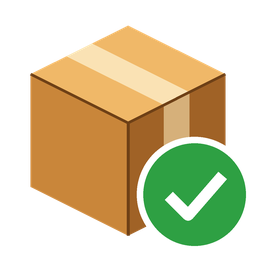

# Package Tracker for Home Assistant



Package Tracker keeps a list of your incoming parcels inside Home Assistant. You paste in
a tracking number (or a whole shipping e-mail) and it:

- **detects the carrier** from the number's format and check digit (UPS, USPS, FedEx,
  DHL, Amazon, OnTrac/LaserShip, Canada Post, Royal Mail, Australia Post, Deutsche Post,
  La Poste, Japan Post and other UPU postal items);
- gives you a **link straight to the carrier's tracking page**. If the carrier has no
  link format, you get its homepage, a copy button and a universal tracker such as
  17TRACK instead;
- remembers the **expected delivery date**, or a delivery window, and **highlights
  overdue packages**;
- lets you tick **Arrived**, then archives the package to a history view.

It also provides sensors, a delivery calendar, a daily digest notification, bus events for
automations, and a bundled dashboard card that loads automatically.

### What it does *not* do: live tracking

Package Tracker **never contacts a carrier**. It cannot see scan events or delivery
status, and it does not change a package's expected date by itself. You enter the date
from the shipping e-mail or the carrier page, and you mark packages as arrived.

**Why:** the carriers' tracking APIs need business accounts, approval or paid plans, and
scraping their sites is fragile and often against their terms. Without them, the
integration has no accounts, API keys, pip requirements, polling, rate limits or cloud
dependency. It runs entirely inside Home Assistant.

## Features

- Carrier detection that works offline, with check-digit validation. Ambiguous numbers
  get ranked candidates, and you can always override the carrier.
- Pasted carrier links work too. Outlook SafeLinks and Google redirect wrappers are
  unwrapped.
- Extraction of tracking numbers from text. Paste a shipping e-mail into the card, or call
  a service from an automation (see the [IMAP recipe](docs/examples/imap_auto_add.yaml)).
  Filters reject order numbers, phone numbers, ZIP+4 codes, IMEIs, gift cards and
  marketing links.
- Description, vendor, notes, an expected date or delivery window, and an optional custom
  tracking link for each package.
- Overdue and due-today status, computed in Home Assistant's time zone.
- A daily digest to notify entities, mobile-app notify services and/or a persistent
  notification, plus an optional notification when a package is marked arrived.
- Events for automations: `added`, `due_today`, `overdue`, `arrived`, `archived` and
  `removed`. They appear in the logbook.
- Sensors (active, overdue, due today, next delivery) and a **Deliveries** calendar.
- Arrived packages are archived automatically, and old history can be purged.
- A bundled Lovelace card with a sortable status table, copy buttons, an add form with
  live carrier detection, a paste dialog, inline editing and history. It has a visual
  editor and supports mobile layouts and dark mode.
- Diagnostics with personal data redacted.

## Installation

Requires **Home Assistant 2026.7 or newer**.

### HACS (custom repository)

1. In Home Assistant, open **HACS**.
2. Open the ⋮ menu and choose **Custom repositories**.
3. Add `https://github.com/your-github-user/HAPackageTracker` with type **Integration**.
4. Search for **Package Tracker**, open it and choose **Download**.
5. **Restart Home Assistant.**

### Manual

1. Download the latest release, or clone this repository.
2. Copy `custom_components/package_tracker` into your Home Assistant configuration
   directory, so that you have `<config>/custom_components/package_tracker/manifest.json`.
3. **Restart Home Assistant.**

## Setup

1. Go to **Settings → Devices & services → Add integration** and search for **Package
   Tracker**.
2. Confirm. There is nothing to fill in, and only one instance can be added.
3. Optionally, open **Configure** on the integration to set up notifications and
   housekeeping (see [Options](#options)).
4. Add the card to a dashboard (next section).

## The card

The card ships with the integration and is **registered automatically**. You do not need
to add a dashboard resource or download a separate frontend plugin.

**Add it from the card picker.** Edit a dashboard, choose **Add card**, search for
**Package Tracker** and select it. The visual editor shows every option.

**Or add it in YAML**, with every option shown at its default:

```yaml
type: custom:package-tracker-card
title: Packages        # card heading; set to "" to hide it
show_add_form: true    # the add form and "Paste text" button
show_history: true     # the "History" button (archived packages, restore/delete)
hide_arrived: false    # hide packages already marked as arrived (until archived)
```

| Option | Type | Default | Description |
|---|---|---|---|
| `title` | string | `Packages` | Card heading. An empty string hides it. |
| `show_add_form` | boolean | `true` | Shows the add form (tracking number with live carrier detection, carrier, description, vendor, expected date or window, notes) and the **Paste text** dialog. Turn it off for a read-only wall tablet. |
| `show_history` | boolean | `true` | Shows the **History** button, which lists archived packages with Restore and Delete. |
| `hide_arrived` | boolean | `false` | Hides arrived packages from the table until they are archived. |

What the card shows:

- **Rows.** Rows are sorted overdue first, then due today, then by expected date, then
  packages with no date, then arrived packages. Overdue rows have a red tint and an
  **Overdue** badge, and due-today rows are amber. Status is never shown by colour alone.
- **Tracking column.** The tracking number links to the carrier's page in a new tab,
  with a **Copy** button. The copy button works over plain `http://` and in the companion
  app. When there is no deep link, the carrier homepage and the fallback tracker are
  offered instead.
- **Paste text.** Paste an e-mail or any text. Numbers found in it are listed with
  checkboxes, and confident new ones are pre-checked. Adding them shares one description
  and date.
- **Not loaded.** If the integration is not set up, the card says so instead of showing
  an error.

## Services

All services are in the `package_tracker` domain. Most actions target a package with
**either** `package_id` **or** `tracking_number`. `update_package` is the exception: when
it is given `package_id`, `tracking_number` sets a *new* number.

| Service | Fields | Response |
|---|---|---|
| `add_package` | `tracking_number`* (a number or a carrier tracking link), `carrier` (`auto` or a carrier id), `description`, `vendor`, `notes`, `expected_date`, `expected_date_end`, `tracking_url` | optional: `{package, candidates}` |
| `update_package` | `package_id` or `tracking_number`, plus any `add_package` field. `null` clears a field, and `carrier: auto` re-detects. | optional: `{package}` |
| `mark_arrived` | `package_id` or `tracking_number`, `arrived` (default `true`; `false` un-marks) | none |
| `archive_package` | `package_id` or `tracking_number` | none |
| `restore_package` | `package_id` or `tracking_number` | none |
| `remove_package` | `package_id` or `tracking_number` (permanent) | none |
| `extract_tracking_numbers` | `text`* (the first 100,000 characters are read) | required: `{results}` |

\* required

Carrier ids: `ups`, `usps`, `fedex`, `dhl`, `amazon`, `ontrac`, `canada_post`,
`royal_mail`, `australia_post`, `deutsche_post`, `la_poste`, `japan_post`, `china_post`,
`india_post`, `postnl`, `intl_post` and `unknown`.

Errors are translated and shown in the UI:

- not loaded
- package not found
- already tracked (`duplicate_package`)
- in history, restore it instead (`in_history`)
- end date before start date (`invalid_date_range`)
- not a tracking number

### Examples

Add a package and read back the detected carrier:

```yaml
action: package_tracker.add_package
data:
  tracking_number: "1Z999AA10123456784"
  description: Running shoes
  vendor: Example Store
  expected_date: "2026-10-14"
  expected_date_end: "2026-10-16"
response_variable: added
# added.package.carrier_name == "UPS", added.package.tracking_url == "https://www.ups.com/track?..."
```

Change the date or clear the notes:

```yaml
action: package_tracker.update_package
data:
  tracking_number: "1Z999AA10123456784"
  expected_date: "2026-10-15"
  notes: null
```

Mark a package as arrived. For example, call this from an NFC tag or an actionable
notification:

```yaml
action: package_tracker.mark_arrived
data:
  tracking_number: "1Z999AA10123456784"
```

Find numbers in text:

```yaml
action: package_tracker.extract_tracking_numbers
data:
  text: "Your UPS tracking number is 1Z999AA10123456784"
response_variable: found
# found.results[0]: {tracking_number, carrier, carrier_name, service, confidence,
#   checksum_valid, source, candidates, tracking_url, already_tracked, package_id, context}
```

Each package dictionary in a response has these fields:

- `id`, `tracking_number`, `carrier`, `carrier_name`, `carrier_source` (`auto` or `manual`), `service`
- `description`, `vendor`, `notes`
- `expected_date`, `expected_date_end`, `status`, `days_until`
- `tracking_url_override`, `tracking_url`, `homepage_url`, `fallback_url`, `copy_only`
- `created_at`, `updated_at`, `delivered_at`, `archived_at`

`status` is one of `no_date`, `in_transit`, `due_today`, `overdue`, `arrived` or
`archived`.

## Events

| Event | Fired when |
|---|---|
| `package_tracker_added` | A package is added. |
| `package_tracker_due_today` | A package's expected date (or window) reaches today. Fires once per package. |
| `package_tracker_overdue` | A package passes its expected date (or the end of its window) without being marked arrived. Fires once per package. |
| `package_tracker_arrived` | A package is marked arrived. |
| `package_tracker_archived` | A package is archived, by hand or automatically. |
| `package_tracker_removed` | A package is deleted, by hand or by the history purge. |

Every event carries `package_id`, `tracking_number`, `carrier`, `carrier_name`,
`description`, `vendor`, `expected_date`, `expected_date_end`, `tracking_url` and
`status`. `tracking_url` is the deep link, or the fallback link when there is no deep
link.

`due_today` and `overdue` are de-duplicated with stored state, so restarts and reloads
never repeat them. Events that would happen while Home Assistant is starting are held
back until startup finishes, so your automations are loaded and receive them.

```yaml
# Push a notification when a package becomes overdue; tapping it opens the tracking page.
triggers:
  - trigger: event
    event_type: package_tracker_overdue
actions:
  - action: notify.mobile_app_phone
    data:
      title: Package overdue
      message: >-
        {{ trigger.event.data.description or trigger.event.data.tracking_number }}
        ({{ trigger.event.data.carrier_name }}) was expected {{ trigger.event.data.expected_date }}.
      data:
        url: "{{ trigger.event.data.tracking_url or '/lovelace' }}"
        clickAction: "{{ trigger.event.data.tracking_url or '/lovelace' }}"
```

```yaml
# Announce when someone marks a package as arrived.
triggers:
  - trigger: event
    event_type: package_tracker_arrived
actions:
  - action: notify.notify
    data:
      message: "{{ trigger.event.data.description or 'A package' }} has arrived."
```

More examples are in [`docs/examples/automations.yaml`](docs/examples/automations.yaml),
including a due-today TTS announcement and a porch reminder. An e-mail auto-add recipe
is in [`docs/examples/imap_auto_add.yaml`](docs/examples/imap_auto_add.yaml).

## Options

Open **Settings → Devices & services → Package Tracker → Configure**. Saving the options
reloads the integration.

| Option | Default | Description |
|---|---|---|
| Daily digest time (`notify_time`) | `08:00` | When the digest of due-today and overdue packages is sent. If Home Assistant was down at that time, the digest is sent after startup, at most once a day. Nothing is sent when no package qualifies. |
| Notify about (`notify_on`) | due today, overdue | What triggers notifications. `due_today` and `overdue` go into the daily digest. `arrived` sends a notification as soon as a package is marked arrived. |
| Notify entities (`notify_entities`) | none | `notify.*` entities that receive the message through `notify.send_message`. Links are written into the message text. |
| Legacy notify services (`notify_services`) | none | Services such as `mobile_app_my_phone`. Tapping the notification opens the tracking page. |
| Show a persistent notification (`persistent_notification`) | on | Also shows the digest in Home Assistant's notification panel. A new digest replaces the previous one. |
| Remind about overdue packages every day (`remind_overdue_daily`) | off | Off: each overdue package is in the digest once. On: it is repeated every day until it is marked arrived or the date changes. |
| Archive arrived packages after (days) (`archive_after_days`) | `7` | Arrived packages move to the history this many days after arrival. `0` keeps them in the list until you archive them by hand. |
| Delete archived packages after (days) (`purge_after_days`) | `0` | Deletes history older than this. `0` keeps history forever. |
| Fallback tracking site (`fallback_tracker`) | 17TRACK | A universal tracker link offered for every package: `17track`, `parcelsapp` or `none`. It is useful for unknown and international numbers. |

Changing a package's dates resets its notification state, so the new date is announced
again.

## Sensors and calendar

All entities belong to one **Package Tracker** service device. There are no per-package
entities.

| Entity | State | Attributes |
|---|---|---|
| `sensor.package_tracker_active_packages` | Packages not yet arrived (no date, in transit, due today or overdue) | `packages` |
| `sensor.package_tracker_overdue_packages` | Overdue packages | `packages` |
| `sensor.package_tracker_packages_due_today` | Packages due today (including windows that include today) | `packages` |
| `sensor.package_tracker_next_delivery` | Date of the next expected delivery (device class `date`), or unknown | `packages` expected on that date |
| `calendar.package_tracker_deliveries` | On during an expected delivery day | standard calendar attributes |

`packages` is a list of up to 25 entries. Each has `id`, `tracking_number`, `carrier`,
`description`, `vendor`, `expected_date`, `expected_date_end` and `status`. It is useful
in templates:

```jinja
{{ state_attr('sensor.package_tracker_packages_due_today', 'packages')
   | map(attribute='description') | join(', ') }}
```

This attribute is **not recorded** in history.

The **Deliveries** calendar shows one all-day event per package with an expected date,
covering the whole window if there is one. The title is "Delivery: …", or "Arrived: …"
once the package is marked. Use it in the calendar dashboard or with calendar triggers.

## Supported carriers

| Carrier | Formats recognised | Deep link |
|---|---|---|
| UPS | `1Z…` (checksum), Mail Innovations, `T…` | yes |
| USPS | IMpb 22/26/30 digits (checksum), 20-digit, `420`+ZIP routing, S10 `…US` | yes |
| FedEx | 12 digits (checksum), 15, `96…` 22-digit, 34-digit barcode, SSCC | yes |
| DHL | Express 10/11 digits (checksum), `JJD…`/`JVGL…`, eCommerce `GM…` | yes |
| Amazon Logistics | `TBA…`/`TBC…`/`TBM…` | yes (may require sign-in) |
| OnTrac / LaserShip | `C…`/`D…` (checksum), LaserShip `1LS…` and `L…` | yes |
| Canada Post, Royal Mail, Australia Post, Deutsche Post, La Poste, Japan Post | UPU S10 (`AA123456785GB`, checksum). Also Canada Post 16-digit, Deutsche Post `00340434…` SSCC, and 12-digit Deutsche Post or Japan Post numbers when Home Assistant's country is DE or JP. | yes |
| China Post, India Post, PostNL, other postal operators | UPU S10 | homepage, copy and fallback |
| Anything else | saved as "Unknown carrier" | fallback tracker and copy |

The full format list, checksums, link templates and their verification status are in
[docs/carriers.md](docs/carriers.md). Carrier sites change, so if a link breaks, set a
custom **tracking link** on that package and open an issue.

## Privacy

- **Everything stays local.** Packages are stored in `.storage/package_tracker.packages`.
  Nothing is sent to any carrier or third party. Your browser only contacts a carrier or
  tracking site when you click a link. The links use `rel="noreferrer"`.
- **Service call data is recorded.** Home Assistant writes every service call's data to
  the recorder database as a `call_service` event. This includes tracking numbers,
  descriptions and notes passed to `add_package` and `update_package`, and the **full
  text** passed to `extract_tracking_numbers`. Keep that in mind before you pipe whole
  e-mails through the service from an automation.
- **The card's paste dialog is not recorded.** It sends the text over the websocket
  connection, scans it and discards it. Nothing is written to the database.
- **Sensor `packages` attributes are excluded** from the recorder.
- **Diagnostics** downloads redact tracking numbers, notes, custom links and user ids.
- **Removing the integration deletes all packages and history.** The store file is
  deleted when the config entry is removed. Disable the integration instead if you only
  want to pause it.

## Limitations

- **No live tracking.** See [above](#what-it-does-not-do-live-tracking). Dates and
  arrival are entered by you or your automations.
- **Detection is by format only.** Some formats are shared between carriers, such as
  12–15 digit numbers and USPS-delivered labels from FedEx, UPS or DHL. The best guess
  is pre-selected and you can change it. Check digits catch most typos, but not all.
- **The card does not load on Google Cast or in safe mode.** Extra frontend modules are
  not loaded there.
- **After removing the integration,** the card's JavaScript stays loaded in open browsers
  and is still served until Home Assistant restarts.
- **Every Home Assistant user sees every package.** There is no per-user filtering yet,
  though `added_by` is recorded for it.
- **Amazon's tracking page** (`track.amazon.com`) may ask you to sign in, or may only work
  for the recipient's account.
- **Carrier link templates** are based on public URL formats and are not live-verified
  for every carrier. See [docs/carriers.md](docs/carriers.md).

## Documentation

- [docs/carriers.md](docs/carriers.md): formats, checksums, link templates and
  references
- [docs/architecture.md](docs/architecture.md): how it fits together and why
- [docs/development.md](docs/development.md): development setup, tests, local Home
  Assistant, releases, and adding a carrier
- [CHANGELOG.md](CHANGELOG.md)

## Placeholder repository owner

`your-github-user` is a placeholder for the repository owner's GitHub handle. It appears
in `manifest.json` (`codeowners`, `documentation`, `issue_tracker`), the card's
documentation link, this README and the CHANGELOG links. Replace it before you publish.

## License

[MIT](LICENSE). The vendored [lit](https://lit.dev) bundle in
`custom_components/package_tracker/www/vendor/` is BSD-3-Clause (Google LLC). Its license
headers are kept in the file.
